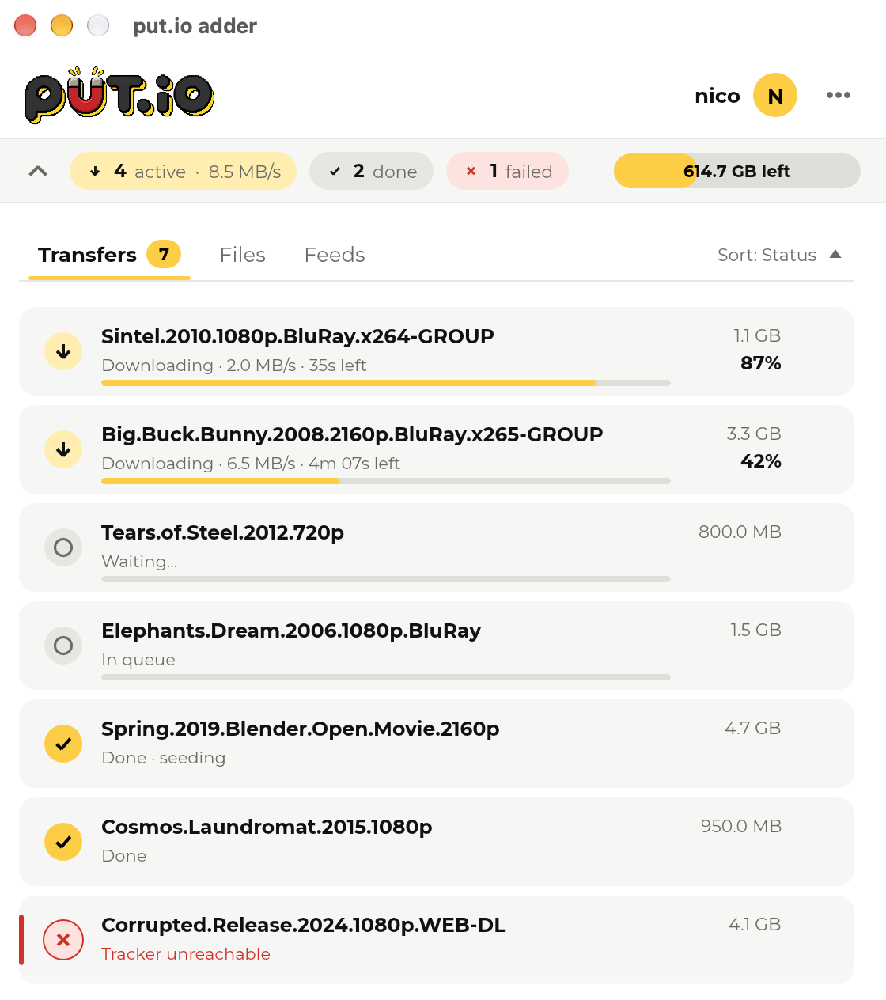
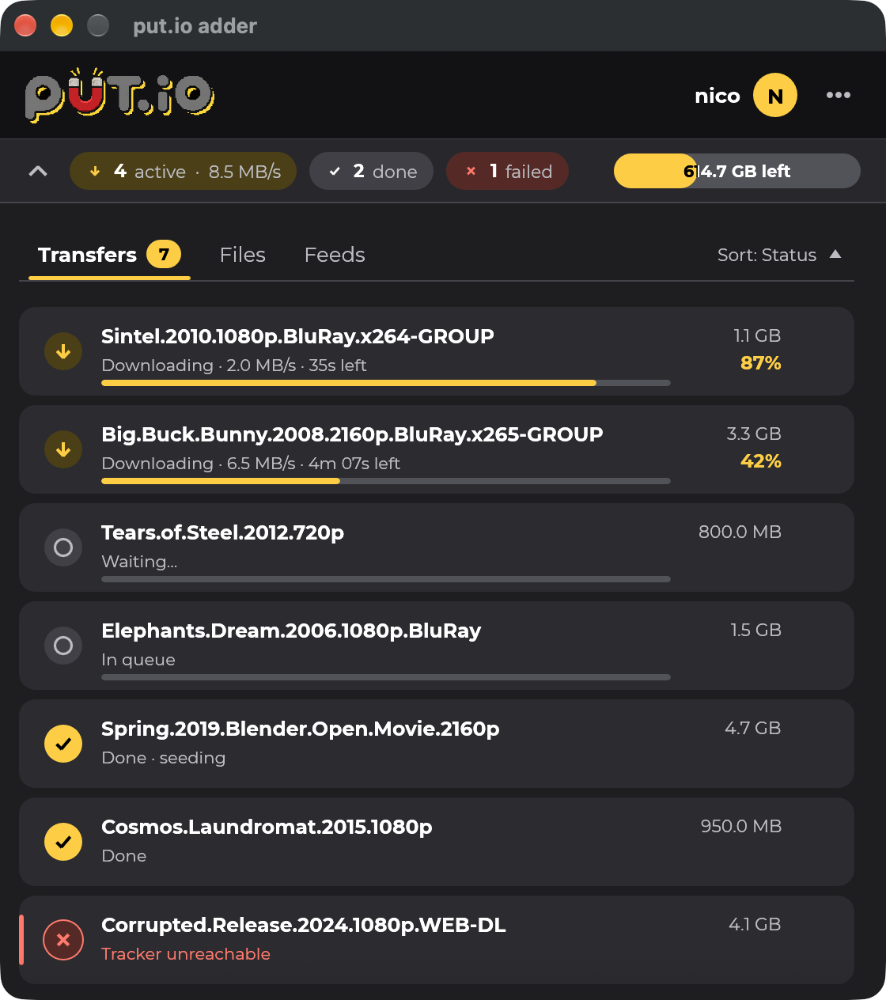

# put.io adder

Click a `magnet:` link or open a `.torrent` file and it lands in your [put.io](https://put.io) queue.
A small cross-platform app for **macOS, Windows and Linux** (x86-64 and arm64), written in Rust.

- **Magnet links and `.torrent` files** go straight to your put.io queue. The app asks once whether it should be the default app for them, and sets itself up if you say yes
- **Your transfers** at a glance: progress, speed, ETA and size, sorted how you like, with a notification when one finishes
- **Right-click a transfer** (or use its "⋯" button) for a details panel (peers, share ratio, tracker message, dates), retry, copy the put.io link or the magnet link, cancel or stop seeding, clear finished ones, stream in [VLC](https://www.videolan.org/vlc/), or download the file or folder through your browser
- **Updates itself** from GitHub releases when you press *Update now* (see [What the updater checks](#updates))
- Optional: choose the put.io folder new transfers are saved in
- Light and dark theme, a resizable window, English, German and Spanish

<table>
  <tr>
    <th align="center">Light</th>
    <th align="center">Dark</th>
  </tr>
  <tr>
    <td></td>
    <td></td>
  </tr>
</table>

## Install

Download the file for your system from the [latest release](https://github.com/nicoSWD/put.io-adder/releases/latest).

| System | File | Notes |
|---|---|---|
| macOS (Apple Silicon / Intel) | `putio-adder-vX.Y.Z-macos-arm64.dmg` / `-x64.dmg` | Drag the app to *Applications*. If the build is not notarized, right-click → *Open* once. |
| Windows (x64 / arm64) | `…-windows-x64-setup.exe` (or the `.zip`) | Installs for your user, no administrator rights. |
| Linux (x86_64 / aarch64) | `putio-adder-vX.Y.Z-linux-x86_64.tar.gz` | Unpack, run `./install.sh` (add `--set-default` to take over magnet links). Needs a Secret Service (GNOME Keyring, KWallet). |

<a id="updates"></a>
## Updates

When a newer stable release exists, the transfers toolbar shows **Update now**. It downloads the file for your system from GitHub, unpacks it next to the app, and swaps it in when you press **Restart to finish**. It will not update a development build, or an app in a folder you cannot write to (it then offers *View release*).

**What it does not check:** the app does not verify a checksum, a tag signature or a code signature of what it downloads. It does take the file only from this project's GitHub releases over HTTPS, with size limits and a bounded unpack. Details and the reasoning: [docs/updates.md](docs/updates.md). Prefer to verify by hand? Turn off *Check for updates* in Preferences and use the next section.

## Verify your download

Releases are built by GitHub Actions from a signed tag. Every file has a build-provenance attestation, and there is a `SHA256SUMS` file and a software bill of materials (`sbom.cdx.json`):

```sh
shasum -a 256 -c SHA256SUMS --ignore-missing
gh attestation verify <file> --repo nicoSWD/put.io-adder
```

## Status

Early. Everything has been run on macOS (Apple Silicon) only. The code for Windows and Linux (keychain, registering as the default app, updating in place, the installer) is written and unit-tested, but it has not been compiled by CI or run on those systems yet, and no release has been published. Treat those as untested until a release candidate has been tried on real machines ([docs/releasing.md](docs/releasing.md)).

## Build from source

```sh
make                   # the optimised binary: target/release/putio-adder
make app               # macOS: target/put.io adder.app (make open also starts it)
make check             # format, clippy and tests, as CI runs them
make help              # lists every task
```

Without `make`: `cargo build --release --locked -p putio-adder` and `tools/bundle-macos.sh`.

Rust is pinned in `rust-toolchain.toml`. Everything builds with `--locked`.

To look at the UI without an account (debug builds only, no network and no Keychain): `make demo` (or `make demo VIEW=prefs THEME=dark`). The views, and the other developer notes, are in [docs/development.md](docs/development.md).

## How it is built

A pure state machine (`putio-core`) decides what the app does; thin crates do the I/O (`putio-api` for put.io, `putio-platform` for the OS, `putio-adder` for the window). See [docs/architecture.md](docs/architecture.md). Security is the main design constraint: [SECURITY.md](SECURITY.md), [docs/dependencies.md](docs/dependencies.md), [docs/platform.md](docs/platform.md). Updates: [docs/updates.md](docs/updates.md). Cutting a release: [docs/releasing.md](docs/releasing.md).

## Licence

MIT. The put.io name and logo belong to put.io. Montserrat is under the SIL Open Font License. See [assets/PROVENANCE.md](assets/PROVENANCE.md).
